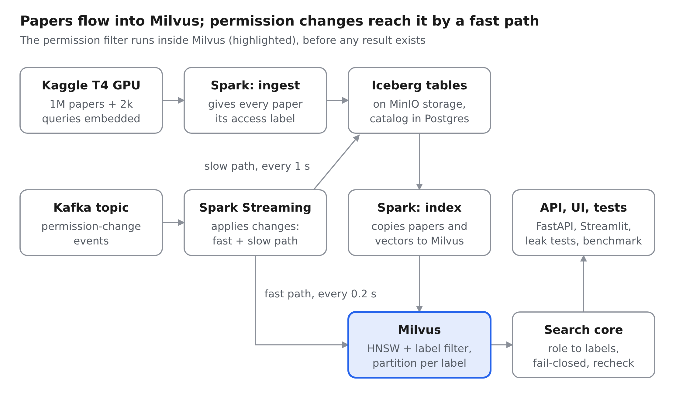
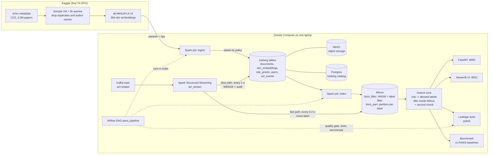
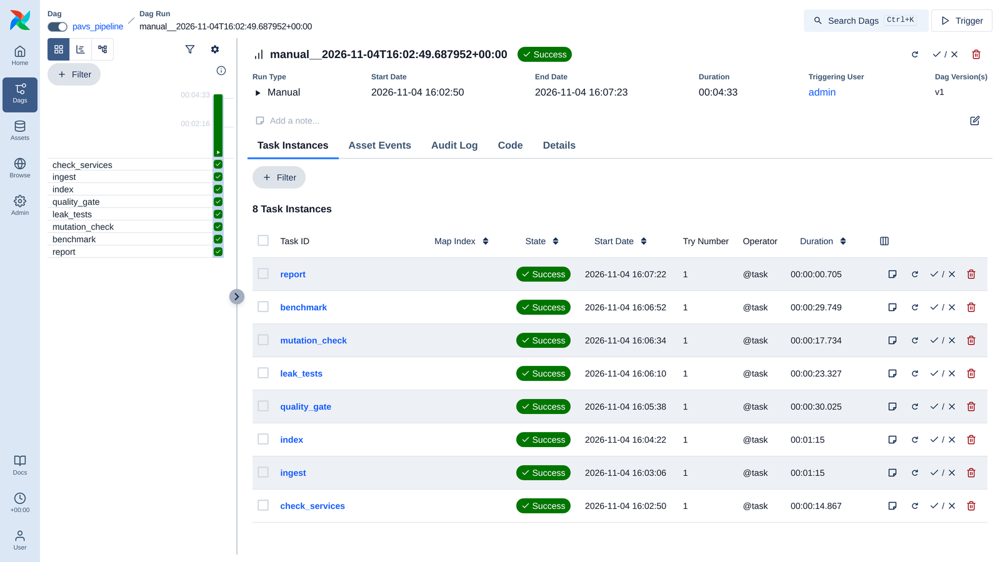

# Permission-Aware Vector Search

BDSRAE Level 3 project (Big Data Systems and Responsible AI Engineering), PES University.

Team: Akshat Agarwal (PES1UG24AM024), Aman Priyansh (PES1UG24AM030), Aditya Kalloli (PES1UG24AM015)

## Problem

An enterprise search system must never return a document that a user is not allowed to see.

We build semantic (vector) search over 1 million arXiv papers in which every paper has an access label and every
user has a role. We then:

1. compare five ways of enforcing permissions in vector search (two in Milvus, three FAISS baselines),
2. measure how restrictive permissions change **latency** and **recall**,
3. attack the system with a **leakage test suite** (users of different roles, targeted and injection attacks),
4. measure how long a document stays visible after its access is **revoked** (streaming pipeline),
5. run the whole batch side as one **Airflow** pipeline with a data-quality gate, so a bad load never reaches users.

## Architecture

The same flow as a Mermaid diagram (renders on GitHub):

## Methods compared

| Method | How the permission is enforced |
|---|---|
| Milvus filter | One collection; `access_label in [...]` filter applied inside the HNSW search |
| Milvus partition | One partition per label; search only the partitions the role may read |
| FAISS pre-filter | FAISS HNSW with an IDSelector of allowed ids (library, no database) |
| FAISS post-filter | Search everything, then drop forbidden results (naive approach most tutorials show) |
| FAISS post-filter 10x | Fetch 10x more candidates, then drop forbidden results (common workaround) |

Ground truth for recall is exact search over only the documents the user may see.

## Repository layout

| Path | What it is |
|---|---|
| `docker-compose.yml` | Whole stack: Milvus (+etcd, MinIO), Kafka, Postgres, app, API, UI, Airflow |
| `orchestration/dags/pavs_pipeline.py` | Airflow DAG: ingest, index, quality gate, leak tests, mutation check, benchmark, report |
| `Dockerfile`, `requirements.txt` | App image (Python 3.12, Java 17, Spark 4.0.4, CPU PyTorch) |
| `VERSIONS.md` | Every pinned version and why |
| `DATA_CARD.md` | Dataset, labels, personal-data handling, limitations |
| `notebooks/01_kaggle_embed_arxiv.ipynb` | Embedding job (run on Kaggle) |
| `src/pavs/policy.py` | Labels, roles, users, label rule (single source of truth) |
| `src/pavs/jobs/` | Spark jobs: ingest to Iceberg, index to Milvus, ACL stream; `quality.py` data-quality gate |
| `src/pavs/search.py` | Permission-aware search core (filter inside Milvus + second check) |
| `src/pavs/api.py`, `src/pavs/ui.py` | FastAPI search API, Streamlit demo |
| `src/pavs/bench.py`, `src/pavs/revocation_bench.py` | Latency/recall benchmark, revocation leak-window benchmark |
| `src/pavs/revocation_breakdown.py`, `src/pavs/plot_revocation.py` | Where the leak window comes from; comparison figure |
| `notebooks/02_results.ipynb` | Results notebook (reads `results/`, all tables and figures) |
| `TECHNICAL_REPORT.md` / `TECHNICAL_REPORT.pdf` | 5-page technical report |
| `MODEL_CARD.md` | How the embedding model is used, risks |
| `docs/architecture*.png` | Architecture diagrams (sources: `.mmd`) |
| `tests/test_leakage.py` | Leakage test suite |
| `results/` | Benchmark CSVs and plots |
| `checks/*.bat` | One-click scripts for Windows |

## Setup (Windows + Docker Desktop, 16 GB RAM)

1. `checks\03_set_docker_memory.bat` once (gives Docker 11 GB), then restart Docker Desktop
2. `checks\01_build_and_start.bat` (first run downloads about 5-6 GB)
3. `checks\02_run_smoke_tests.bat` (checks every component)
4. Run `notebooks/01_kaggle_embed_arxiv.ipynb` on Kaggle (GPU T4), download its output files into `data\kaggle\`
5. `checks\10_load_demo100k.bat` (Spark -> Iceberg -> Milvus)
6. `checks\11_leak_tests.bat`, `checks\12_benchmark_demo100k.bat`
7. `checks\14_revocation_test.bat`, `15_revocation_tuned.bat`, `16_revocation_split.bat` (revocation experiments)
8. `checks\20_load_1m.bat` then `checks\25_bench_1m_two_runs.bat` (1M documents; Milvus and FAISS are measured in
   separate runs so the 16 GB laptop does not swap. Do not use `22_index_and_bench_1m.bat`, our first attempt)
9. `checks\40_finish_all.bat` (1M leakage tests, mutation check, results notebook, demo recording)
10. `checks\13_start_demo.bat` opens the demo at http://localhost:8501 (API docs at http://localhost:8000/docs)
11. `checks\99_shutdown_everything.bat` stops all containers and Docker's VM (data stays saved)
12. `checks\32_check_demo.bat` (while the demo runs) checks the UI and API and prints example searches per role
13. `checks\92_push_to_github.bat` pushes your commits to GitHub (the remote is set by `91_connect_github.bat`)

**Orchestrated route (Airflow).** Steps 5 and 6 as one pipeline:

1. `checks\50_start_airflow.bat` starts the stack plus Airflow (http://localhost:8080, login admin / admin, local only)
2. `checks\51_run_pipeline.bat` triggers the `pavs_pipeline` DAG and follows it to the end
   (`--skip-load` keeps the current index; `--prefix corpus1m` loads 1M). Or press Trigger in the Airflow UI.

On Linux/macOS run the same `docker compose exec app python -m ...` commands that the `.bat` files contain.

## Orchestration (Airflow)

`pavs_pipeline`: `check_services → ingest → index → quality_gate → leak_tests → mutation_check → benchmark → report`

- Airflow 3.3 runs each step **inside the existing app container** (Docker socket), so it adds no second copy of Spark.
- `quality_gate` (`src/pavs/jobs/quality.py`) stops the run unless source files, Iceberg and both Milvus collections
  agree row for row and label by label, labels are all known to the policy, label shares match the rule, and no vector is broken.
- `leak_tests` and `mutation_check` never retry: a security test that passes on a retry is a flaky security test.
  `mutation_check` disables the filter on purpose and passes only if the leak tests then **fail**.
- One run writes `results/airflow/pipeline_report_<prefix>.md`, `results/quality_<prefix>.json` and `results/bench_airflow_<prefix>.csv`.
- Measured on the laptop (100k documents): the whole DAG ran in **4 min 33 s**, every task green, 8/8 quality checks and 38/38 leak tests passed.

## Results (measured on the laptop, details in `TECHNICAL_REPORT.pdf`)

On 1,000,000 arXiv documents, k=10, 500 queries per point:

| Selectivity (share of docs the user may see) | 50% | 5% | 1% | 0.1% |
|---|---|---|---|---|
| Milvus filter: recall@10 | 0.957 | 1.000 | 1.000 | 1.000 |
| Milvus partition: recall@10 | 0.957 | 0.976 | 0.994 | 1.000 |
| FAISS pre-filter: recall@10 | 0.933 | 0.583 | 0.443 | 0.094 |
| Naive post-filter: recall@10 | 0.497 | 0.049 | 0.013 | 0.002 |
| Milvus filter: p95 latency (ms) | 6.6 | 14.3 | 8.8 | 5.1 |

- Leakage suite: 38 tests, 0 leaks on the 100k and the 1M index; a mutation check (filter disabled on purpose) makes the suite fail, as it should.
- Revocation leak window (median): 5.0 s with the first stream job, 1.0 s after splitting it into a fast Milvus path and a slow Iceberg path.
- Figures: `results/recall_vs_selectivity_*.png`, `results/latency_vs_selectivity_*.png`, `results/revocation_comparison.png`.

## Version 2 (planned, not in this submission)

Real sign-in (Keycloak tokens instead of the demo `X-User` header), per-document sharing with a policy engine
(OpenFGA), a small LLM answer step that only ever sees allowed documents (with prompt-injection tests),
monitoring with a leak alert (Prometheus + Grafana), and CI that runs the leakage suite on every change.
