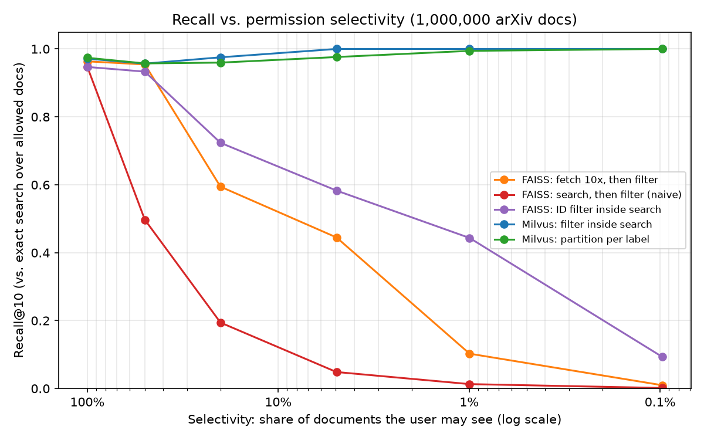
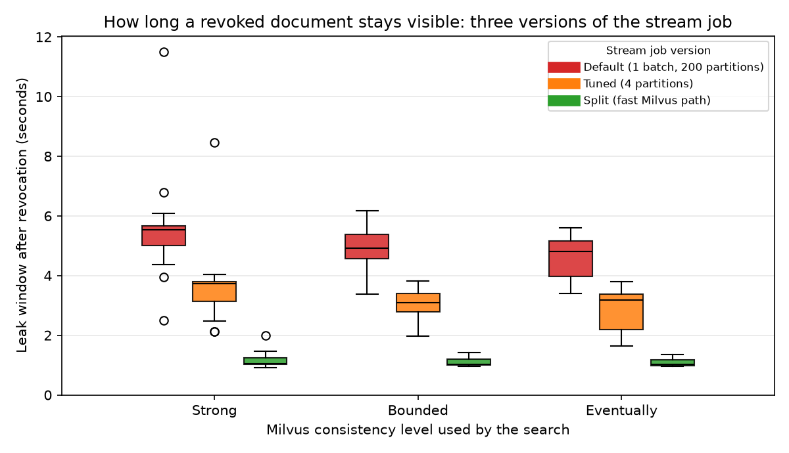

# 1. Problem

Retrieval-augmented generation (RAG) systems put a company's documents into a vector database and fetch
the most similar ones for every question. If the search ignores who is asking, an intern's question can
return a board-only document, and the language model will happily summarise it. The search itself
must respect permissions.

The obvious fix, *search first, then delete the results the user may not see* (post-filtering), is
both **unsafe** (restricted documents reach application code) and **inaccurate** (when a user may see
only 1% of documents, almost all of the top-k results are deleted and the user gets nearly nothing).

**Goal.** Build a permission-aware vector search over 1,000,000 real documents, and measure:
(1) recall and latency when the permission filter is very restrictive, (2) leakage with users of
different roles (must be zero), and (3) how long a revoked document stays visible.

# 2. Data and permission policy

* **Corpus:** arXiv metadata (Cornell University, CC0 licence, 3,224,635 records, 93 duplicate ids
  removed). Random sample (seed 42) of 1,000,000 papers + 2,000 different papers used as queries
  (query text = title, so the query's own abstract is never in the corpus). Author names dropped.
  The first 100,000 rows of the sample are the "demo100k" subset. Details: `DATA_CARD.md`.
* **Embeddings:** `all-MiniLM-L6-v2` (384 dims, normalised) on a free Kaggle T4 GPU,
  1,151 s for all texts (`MODEL_CARD.md`). A laptop CPU does about 50 docs/s, i.e. 5.5 hours.
* **Access labels (synthetic, deterministic):** department from the primary arXiv category
  (cs / math / physics / other), and a hash bucket `CRC32(arxiv_id) mod 10000` decides the level:
  0.1% `board-restricted`, 0.9% `hr-restricted`, 9% `<dept>-confidential`, 40% `<dept>-internal`,
  50% `public` (11 labels). The same rule is written once in Python (`policy.py`) and once in Spark
  SQL; the ingest job checks on a sample that both agree.
* **Roles:** 10 roles and 10 synthetic users, e.g. intern → {public}; cs_manager → {public,
  cs-internal, cs-confidential}; board_member → {public, hr-restricted, board-restricted}; admin → all.
  This gives a wide range of *selectivity* (share of documents a user may see): 0.08% to 100%.

# 3. Architecture

{width=62%}

**Big Data side.** Spark 4.0 reads the Kaggle output, assigns labels and writes **Apache Iceberg**
tables (`documents` partitioned by department, `doc_embeddings`, `role_grants`, `users`,
`acl_events`) to **MinIO** (S3-compatible object storage) with a **Postgres** JDBC catalog. A second
Spark job joins documents and embeddings once and streams them into **Milvus**, which is therefore a
*derived index* that can always be rebuilt from the lakehouse. Permission changes arrive as events on
a **Kafka** topic and are applied by a **Spark Structured Streaming** job (Section 5.3).

**Orchestration.** An **Apache Airflow 3.3** DAG, `pavs_pipeline`, runs the batch side in order:
`check_services → ingest → index → quality_gate → leak_tests → mutation_check → benchmark → report`.
Each task runs the existing job inside the app container, so Airflow adds scheduling, retries,
timeouts and a run history without a second copy of Spark. The **quality gate** stops the run unless
the source files, both Iceberg tables and both Milvus collections hold the same rows, label by label;
every label is one the policy knows; the label shares match the rule (z-score below 5); and no vector
is missing or NaN. Security tasks never retry (a test that passes on a retry is a flaky test), and the
mutation check (5.4) runs on every load. On the laptop a full run on the 100k slice took **4 min 33 s**
(ingest 75 s, index 75 s, quality gate 30 s, leak tests 23 s, mutation check 18 s, benchmark 30 s) and
passed every step: 8 of 8 quality checks, 38 of 38 leak tests, and the same recall as Section 5.1
(`results/airflow/pipeline_report_demo100k.md`, screenshot `docs/airflow_run.png`).

**Search side.** `Searcher.search(user, query)` maps user → role → allowed labels. Unknown users get
an empty allowlist and **no search is run** (fail-closed). The filter expression is built only from
the server-side allowlist (`access_label in ["public", "cs-internal"]`), never from user text, so filter
injection is impossible. Milvus applies the filter **inside** the HNSW search. Every hit is checked a
second time against the allowlist (defence in depth; the counter must stay 0), and every query is
written to an audit log. FastAPI (`/search`, identity in a header) and a Streamlit UI sit on top.

| Method | How the permission is applied | Where |
|----------|------------------------------|----------|
| `milvus_filter` | scalar filter on `access_label` (inverted index) evaluated during the HNSW graph search | Milvus collection `docs_filter` |
| `milvus_partition` | one partition per label; search only the partitions of allowed labels | Milvus collection `docs_part` |
| `faiss_prefilter` | HNSW with an ID selector (allowed ids only) | FAISS in-process |
| `faiss_postfilter` | top-10, then drop forbidden results (the naive approach) | FAISS |
| `faiss_post_10x` | top-100, then drop forbidden results, keep 10 | FAISS |

Ground truth for recall is **exact** search (FAISS `IndexFlatIP` + ID selector) over the allowed
documents only. All HNSW indexes use M=16, efConstruction=200, ef=64; k=10; 500 queries per point.

# 4. Why these tools (and not the alternatives)

| Choice | Instead of | Reason |
|--------|--------|------------------------------------------|
| Milvus 3.0 (open source) | Pinecone | Pinecone is a paid managed service; we need to run, inspect and benchmark the engine on our own laptop. Milvus supports metadata filtering inside the ANN search **and** partitions, so we can compare two strategies in one engine. |
| Milvus | pgvector, Qdrant, Weaviate | All are valid. Milvus is built as a distributed system (separate storage, query and index nodes, object storage underneath), which matches a Big Data course; pgvector's HNSW applies the WHERE clause after the index scan (iterative scans since 0.8 reduce, not remove, the problem); Qdrant would also work and is a fair v2 comparison. |
| FAISS as baseline | (none) | A library, not a database: lets us implement the naive and the pre-filter strategies exactly and compute exact ground truth. |
| Iceberg | Delta Lake, Hudi | Engine-neutral open table format with snapshots and time travel (we can show what a document's label was at any time), works with Spark and a plain JDBC catalog, no vendor lock-in. |
| Kafka | RabbitMQ, direct API calls | Durable, replayable log of permission changes; the stream job restarts from its checkpoint without losing a revocation. |
| Airflow 3 | Prefect, cron | Most widely used orchestrator in data teams; a DAG shows every step, retry and failure in one place. Prefect would also work (lighter, plain Python); cron has no dependencies, retries or history. |
| Spark | pandas | The same code scales from 100k to 1M+ rows and to a cluster; Structured Streaming gives exactly the micro-batch semantics we measure. |

# 5. Results

All numbers below were measured on one laptop (Intel Core Ultra 5 225H, 16 GB RAM, Docker VM limited
to 11 GB) and are reproducible with the scripts in `checks/`. Full tables: `notebooks/02_results.ipynb`.

## 5.1 Recall@10 under restrictive filters

Each cell: recall@10 at 1M documents, with the 100k result in brackets.

| Method \\ selectivity | 100% | 50% | 20% | 5% | 1% | 0.1% |
|------------|------|------|------|------|------|------|
| `milvus_filter` | 0.971 (0.978) | 0.957 (0.971) | 0.975 (0.979) | 1.000 (1.000) | 1.000 (1.000) | 1.000 (1.000) |
| `milvus_partition` | 0.974 (0.991) | 0.957 (0.977) | 0.960 (0.975) | 0.976 (0.998) | 0.994 (1.000) | 1.000 (1.000) |
| `faiss_prefilter` | 0.947 (0.969) | 0.933 (0.955) | 0.724 (0.748) | 0.583 (0.690) | 0.443 (0.476) | 0.094 (0.071) |
| `faiss_post_10x` | 0.963 (0.982) | 0.954 (0.973) | 0.594 (0.633) | 0.445 (0.464) | 0.103 (0.103) | 0.010 (0.008) |
| `faiss_postfilter` | 0.947 (0.969) | 0.497 (0.489) | 0.194 (0.193) | 0.049 (0.048) | 0.013 (0.009) | 0.002 (0.001) |

{width=48%}

**Reading (1M documents).** Both Milvus strategies keep recall between 0.96 and 1.0 at **every**
selectivity. Naive post-filtering collapses exactly as theory predicts: with selectivity *s*, only about
*10·s* of the top-10 results survive (0.50 at 50%, 0.049 at 5%, 0.002 at 0.1%). Fetching 10x more
helps only down to about 20%. Even FAISS pre-filtering drops (0.44 at 1%, 0.09 at 0.1%): an ID selector
inside a plain HNSW walk stops early because most neighbours of each graph node are forbidden. Milvus
avoids this: its search engine (Knowhere) switches from the graph walk to a brute-force scan of the
allowed rows when the filter removes 93% or more of them (milvus-io/milvus issue #51943 documents this
threshold), and the partition method searches only the small allowed partitions.

## 5.2 Latency

| Method \\ selectivity (p95 ms, 1M docs) | 100% | 50% | 20% | 5% | 1% | 0.1% |
|---|---|---|---|---|---|---|
| `milvus_filter` | 19.6 | 6.6 | 10.2 | 14.3 | 8.8 | 5.1 |
| `milvus_partition` | 8.4 | 4.6 | 5.1 | 4.6 | 4.5 | 4.1 |
| `faiss_prefilter` | 1.0 | 1.3 | 0.7 | 0.7 | 0.8 | 0.7 |
| `faiss_post_10x` | 1.4 | 1.1 | 1.0 | 1.0 | 0.9 | 0.9 |
| `faiss_postfilter` | 0.7 | 0.7 | 0.8 | 0.6 | 0.7 | 0.7 |

At 1M documents the Milvus filter answers in 5–20 ms at the 95th percentile, partitions in 4–8 ms. The
filter is slowest with no restriction (100%, the whole graph) and at 5%, where the brute-force scan
covers about 50,000 allowed rows; partitions stay flat because they only touch the allowed partitions.
FAISS is faster in absolute terms, but it runs **inside** the benchmark process, while every Milvus
number includes a gRPC round trip to a separate server; FAISS also has no persistence, no filtering
index, no updates while serving and no access control, so the comparison is about recall, not speed.

**From 100k to 1M documents (10x).** Recall of both Milvus methods did not change (every value stays
between 0.96 and 1.0 at both sizes), and partition p95 latency stayed within 3–8 ms; the filter's p95 rose
from about 5–6 ms to 5–20 ms. Loading 1M documents into both Milvus collections took 411 s (about 2,400 documents
per second, each written to both), and Milvus then held 5.4 of its 6 GB memory limit, which is close to the limit of a
16 GB laptop.

## 5.3 Revocation: how long does a revoked document stay visible?

`revocation_bench.py` takes a public document the intern can find, sends a Kafka event moving it to
`hr-restricted`, and searches as the intern every 50 ms until it disappears. 20 trials for each Milvus
consistency level, three versions of the stream job:

| Stream job version | Leak window p50 | p95 | Event → Milvus p50 | Event → Iceberg p50 |
|---|---|---|---|---|
| Default (1 batch, 200 shuffle partitions) | 5.04 s | 6.12 s | 4.95 s | 8.50 s |
| Tuned (4 shuffle partitions) | 3.19 s | 3.88 s | 3.11 s | 4.69 s |
| **Split fast/slow path** | 1.03 s | 1.44 s | 0.98 s | 7.01 s |

1. **Default** (one micro-batch: Milvus update, then Iceberg MERGE): about 5 s. The breakdown from
   `acl_events` shows the time is spent *before* Milvus is updated: each micro-batch took 3.5–6.7 s
   (Spark's default 200 shuffle partitions for a 1-row MERGE), so a new event waits for the running
   batch to finish.
2. **Tuned** (4 shuffle partitions): about 3 s.
3. **Split** (a fast path Kafka → Milvus every 0.2 s, and a separate slow path Kafka → Iceberg
   MERGE + audit): **about 1 s**. The lakehouse still lags several seconds, but that delay is no
   longer on the security-critical path.

{width=46%}

The Milvus consistency level (Strong / Bounded / Eventually) moved the median by at most 0.7 s in
every version (Strong is slightly slower because each search first waits for Milvus to confirm it has
seen all earlier writes): once Milvus has the update, the next search sees it. **The bottleneck was the
pipeline, not the database.** This is the main engineering lesson of the project.

## 5.4 Leakage test suite

`tests/test_leakage.py` (pytest, run against the live index): **38 tests, 38 passed, 0 leaks**, on the
100k index (24 s) and again on the 1M index (32 s).

* each of the 10 users × 2 Milvus methods × 200 queries, top-50 results each (200,000 results
  checked): no returned document has a label outside the user's allowlist (checked on the raw Milvus
  output, with the second check switched off);
* targeted test: the vectors of restricted documents are used as queries (the most similar
  possible query); unauthorised users never get them, authorised users find more than 90% of them;
* unknown, empty and missing users, wrong case (`ROOT.ADMIN`), trailing space, role names used as
  user names, and an injection string as user name: all fail closed (no search is run);
* six filter-injection payloads (e.g. `public"] or access_label != "x`) are dropped by the allowlist
  builder; `k` is clamped to 100;
* the HTTP API returns the same `403 access denied` for missing and unknown users (no user
  enumeration) and rejects invalid methods and `k` with 422.

**Mutation check (do the tests catch a real leak?).** We re-ran the suite with the filter builder
deliberately broken so it allows everything (`PAVS_MUTATION=no_filter`, test code only): **16 tests
failed**, exactly the ones that depend on that filter (9 non-admin roles on the filter method, the
targeted attack on the filter method, the 6 injection tests). The partition tests still passed, since
that mechanism was not broken, and so did the API test: the search core's second check removed the
forbidden results before they left the server. That is defence in depth working as designed.

# 6. Responsible AI

* **Threat model.** An authenticated user with a low role tries to read restricted content through
  similarity search (normal queries, queries crafted to be close to a restricted document, filter
  injection, unknown identities). Out of scope: a compromised server or stolen admin credentials.
* **Controls with evidence.** Filter inside the search (5.1), fail-closed identity (5.4), allowlist-only
  filter building (5.4), second check with a violation counter (always 0), audit log of every query,
  measured revocation window (5.3), Iceberg time travel to answer "who could see this document on
  date X".
* **Privacy.** Only public CC0 data; author names removed; access labels are synthetic and say
  nothing about real people. Vectors are never returned by the API (embeddings can be partly inverted).
* **Limitations.** Labels are random, not semantic, so restricted documents are not topically
  clustered as in a real company (that would make post-filtering even worse). One label per document;
  real systems need per-user and per-group grants. Identity is a demo header. Single-node Milvus. We did
  not test timing side channels (does latency reveal how many restricted documents match?).
* **Version 2 (planned).** Real sign-in with Keycloak tokens; per-document sharing with the OpenFGA
  policy engine; a small LLM answer step that only sees allowed documents, with prompt-injection tests;
  Prometheus and Grafana with an alert on any leak counter above 0; CI running the leakage suite.

# 7. Reproducibility

`docker compose up -d` starts the stack. The scripts in `checks/` reproduce every number (`10` → `11` → `12`
→ `14/15/16` → `20` → `25` → `40`, logs in `logs/`, results in `results/`); `50_start_airflow.bat` and
`51_run_pipeline.bat` run load, quality gate, tests and benchmark as one pipeline. Versions: `VERSIONS.md`.
At 1M, Milvus and FAISS were benchmarked in separate runs: together they need 8.6 GB and the laptop swapped,
which made a first attempt's latencies meaningless (kept in `results/bench_corpus1m_first_run_swapping.csv`).
